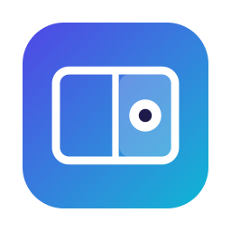

<p align="center"></p>

<h1 align="center">Eyeshift</h1>

**Keyboard focus follows your eyes.** Eyeshift is a macOS menu-bar app that watches your webcam and moves
keyboard focus to the screen, window or split pane you're looking at — so you can just start typing,
without clicking first.

- **Screens** — turn toward another monitor and focus (and the pointer) moves there.
- **Windows** — look at another window on the same screen and it comes forward.
- **Split panes** — in iTerm2, Terminal, Ghostty, Warp, kitty, WezTerm, Hyper, VS Code, Cursor, Windsurf,
  VSCodium, Zed, Sublime Text, Xcode, JetBrains IDEs and Android Studio, focus moves to the pane you look at.
- **Stays out of your way** — never moves focus while you type, use the mouse, or look down at your keyboard.

<p align="center"></p>

Everything runs on your Mac. Camera frames are processed in memory with Apple's Vision framework and thrown
away immediately — nothing is recorded, saved or sent anywhere. No account, no analytics, no network.

## What to expect

Webcam eye tracking is good to roughly a thumbnail-sized area on screen. That's plenty for picking a screen,
window or pane — it is **not** precise enough to point at a word or replace the mouse.

## Requirements

- macOS 14 Sonoma or later (Apple silicon or Intel)
- A webcam (built-in is fine). Optionally a second webcam on your other screen for better accuracy there.
- Xcode or the Xcode Command Line Tools (Swift 5.9+) to build

## Build and run

```sh
git clone https://github.com/itssarthak/eyeshift.git
cd eyeshift
./build.sh                      # builds and installs ~/Applications/Eyeshift.app
open ~/Applications/Eyeshift.app
```

On first launch the welcome guide walks you through:

1. **Camera** permission.
2. **Accessibility** permission — needed to raise windows and move the pointer
   (System Settings → Privacy & Security → Accessibility).
3. **Calibration** — about 45 seconds per screen, in three short phases:
   red dot (eyes only), blue dot (point your nose), green dot (keep looking while moving your head),
   then one look at your keyboard.

> **Rebuilding often?** Run `scripts/make-signing-cert.sh` once. It creates a local signing certificate so macOS
> keeps the Accessibility permission across rebuilds. Without it, builds are ad-hoc signed and macOS forgets the
> permission each time: if Eyeshift keeps asking even though it's ticked, remove it from the Accessibility list
> with **–**, add it again with **+**, and relaunch.

## Using it

The eye icon in the menu bar shows what Eyeshift thinks you're facing, and how much it has learned.

- **⇧⌘G** pauses and resumes.
- **Recalibrate…** after moving your screens or camera.
- **Settings…** (⌘,) — every option is explained in the window: switch delays, how far to turn your head,
  edge margin, typing pause, cameras, and more.
- **Show gaze dot** draws where Eyeshift thinks you're looking — the quickest way to judge accuracy.

### It keeps learning

After calibration, Eyeshift improves as you work:

- every **click** is a hint of where you were looking;
- while you **type**, you're usually looking near the text cursor;
- if it switches focus and you **click somewhere else** within 4 seconds, it learns from the mistake;
- what it learns is kept per *situation* (how you're sitting × where you looked), so postures you use rarely
  aren't forgotten, and a local correction layer fixes errors specific to a posture or part of the screen.

Turn this off in Settings if you prefer a fixed calibration.

## How it works

| Piece | File |
|---|---|
| Camera + face/eye features (head pose, face position, iris, eye-patch pixels) | `Sources/Eyeshift/Tracker.swift` |
| Gaze model: ridge regression (head-only for screens, head + eyes for points) + learned local correction | `Sources/Eyeshift/GazeModel.swift` |
| Calibration screens | `Sources/Eyeshift/Calibration.swift` |
| Turning gaze into focus changes (screens, windows, panes, typing/mouse holds) | `Sources/Eyeshift/Focuser.swift` |
| Settings and welcome windows | `Sources/Eyeshift/Windows.swift` |
| Menu bar app, two-camera blending, learning signals | `Sources/Eyeshift/main.swift` |

Run the built-in self-checks with `swift build && .build/debug/Eyeshift --selftest`.

Your calibration and what Eyeshift has learned live in `~/Library/Application Support/Eyeshift/`.

## Contributing

Issues and pull requests are welcome — especially reports of how well pane focus works in your editor or
terminal, since apps expose their panes to macOS in different ways.

## License

[MIT](LICENSE)
